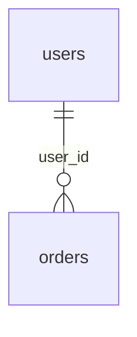

# SQLiteLens

**SQLiteLens** is a lightweight, dependency-free Python CLI for inspecting, documenting, and auditing SQLite databases in read-only mode.

Version: **1.0.0**

It helps developers understand SQLite database structure without opening a GUI tool or writing ad-hoc SQL queries.

## Features

- Read-only SQLite inspection
- Database file size and page statistics
- Table list and row counts
- Column names, types, nullability, defaults, and primary keys
- Index detection
- Unique index detection
- Foreign key inspection
- View inspection
- Trigger inspection
- Tables without primary keys
- Foreign-key columns without supporting indexes
- Optional `PRAGMA integrity_check`
- JSON reports
- Markdown reports
- Mermaid ER diagram output
- CI-friendly exit codes
- No third-party runtime dependencies
- Automated tests
- GitHub Actions workflow

## Why SQLiteLens?

SQLite is everywhere:

- local desktop apps
- mobile apps
- test databases
- analytics caches
- embedded tools
- bots and automation projects
- prototypes
- CLI utilities

But when a database grows, it becomes hard to answer simple questions:

- What tables are inside this database?
- Which tables have the most rows?
- What indexes exist?
- Are foreign keys documented?
- Are foreign-key columns indexed?
- Which tables do not have a primary key?
- Can I export a quick database report for another developer?

SQLiteLens answers those questions from the command line.

## Requirements

- Python 3.9+
- SQLite support included with Python

No runtime dependencies are required.

## Installation

```bash
git clone https://github.com/bafnayeygian/SQLiteLens.git
cd SQLiteLens
python -m pip install .
```

## Quick start

Inspect a database:

```bash
sqlite-lens app.db
```

Write a Markdown report:

```bash
sqlite-lens app.db --markdown database-report.md
```

Write JSON:

```bash
sqlite-lens app.db --json database-report.json
```

Write a Mermaid ER diagram:

```bash
sqlite-lens app.db --mermaid schema.mmd
```

Run SQLite integrity check:

```bash
sqlite-lens app.db --integrity-check
```

## Example console output

```text
SQLiteLens 1.0.0

Database: app.db
Size: 524288 bytes
SQLite page size: 4096
Pages: 128

Tables: 4
Views: 1
Indexes: 5
Triggers: 0

Top tables by row count
  1. orders               12500 rows
  2. users                 1840 rows
  3. products               320 rows

Warnings
- Table logs has no primary key.
- Foreign key orders.user_id references users.id but no supporting index was found.
```

## Reports

### JSON

```bash
sqlite-lens app.db --json report.json
```

### Markdown

```bash
sqlite-lens app.db --markdown report.md
```

### Mermaid

```bash
sqlite-lens app.db --mermaid schema.mmd
```

Mermaid output can be pasted into GitHub Markdown or Mermaid-compatible documentation tools:



## Read-only mode

SQLiteLens opens databases using SQLite URI read-only mode:

```text
file:path/to/database.db?mode=ro
```

It does not modify the database.

## Foreign key index check

SQLiteLens checks whether columns used in foreign keys appear as the leading column of at least one index.

This is a practical heuristic because unindexed foreign-key columns can cause slower joins and constraint checks.

## Tables without primary key

SQLiteLens warns when a normal table does not declare a primary key.

Some SQLite designs intentionally avoid primary keys, so this is a warning, not an error.

## Integrity check

Use:

```bash
sqlite-lens app.db --integrity-check
```

This runs:

```sql
PRAGMA integrity_check;
```

It can be useful in backup verification or CI sanity checks.

## CI example

```yaml
name: sqlite-report

on:
  workflow_dispatch:

jobs:
  inspect:
    runs-on: ubuntu-latest
    steps:
      - uses: actions/checkout@v4

      - uses: actions/setup-python@v5
        with:
          python-version: "3.12"

      - name: Install SQLiteLens
        run: pip install git+https://github.com/bafnayeygian/SQLiteLens.git

      - name: Inspect database
        run: sqlite-lens tests/fixtures/example.db --integrity-check --markdown sqlite-report.md
```

## Python API

```python
from sqlite_lens.inspect import inspect_database

report = inspect_database("app.db", integrity_check=True)

for table in report.tables:
    print(table.name, table.row_count)
```

## Exit codes

- `0` — inspection completed
- `1` — integrity check failed
- `2` — invalid arguments, missing file, or local execution error

Warnings do not fail the command by default.

## Security

SQLiteLens does not execute application code.

It runs read-only SQLite metadata queries and optional integrity checks against a local database file.

Do not run SQLiteLens against database files from untrusted sources in privileged environments unless you trust your local SQLite library and sandboxing setup.

See [SECURITY.md](SECURITY.md).

## Development

Run tests:

```bash
python -m unittest discover -s tests -v
```

Compile check:

```bash
python -m compileall -q src
```

## Contributing

See [CONTRIBUTING.md](CONTRIBUTING.md).

Potential improvements:

- HTML reports
- CSV export
- row sampling
- duplicate-index detection
- migration diff reports
- query-plan helpers
- automatic documentation site output
- database comparison mode
- size estimates per table using `dbstat` when available

## License

MIT License. See [LICENSE](LICENSE).
